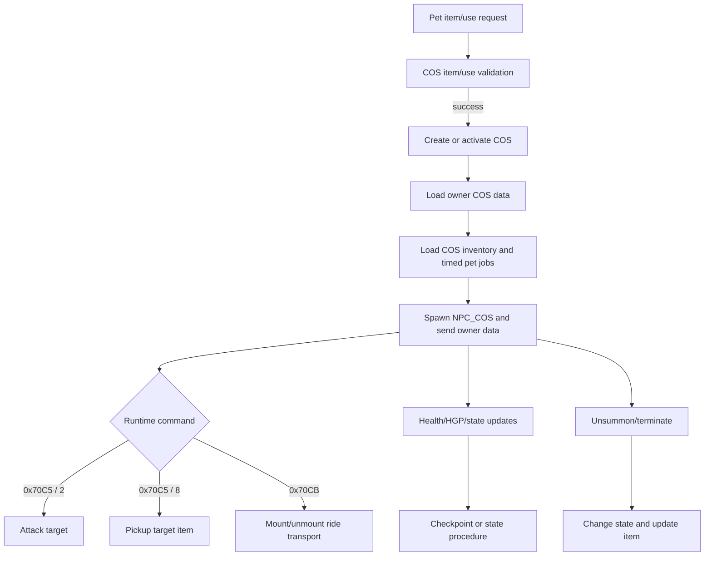

# SR_GameServer pet systems

Binary-first notes for the pinned TestIn `SR_GameServer.exe`. This document
covers the requested Grab Pet, Attack Pet, Transport Pet, Fellow Pet, horse,
pet inventory, and pet-revival surfaces. It deliberately separates direct
binary observations from names supplied by the current AegisCore model or
secondary emulator sources.

## Evidence identity and confidence

- Binary: `..\VSRO_TestIn(EPVP)\VSRO_TestIn\VSRO_TestIn\SR_GameServer.exe`
- SHA-256: `0efe7eafe6e0b8ae3284c377b59211f3a8864713d8674d274105739baac35e35`
- Architecture: 32-bit Windows x86
- Opcode table: [`evidence/sr-gameserver-testin-opcodes.csv`](evidence/sr-gameserver-testin-opcodes.csv)

`confirmed` means the instruction, branch, serializer, SQL literal, or
dispatcher registration is present in this executable. `derived` means the
meaning follows from confirmed reads/writes and an independently matching
vSRO layout. `strong inference` is a cross-check against the checked-in
spawn parser/current implementation, but is not independently named in the
GameServer decompilation. `unresolved` means the evidence is not sufficient.

The binary contains no literal strings named “Grab Pet”, “Attack Pet”,
“Fellow Pet”, or “Horse”. Those are convenient feature names, not binary
symbols. The binary’s own vocabulary is `COS`, `NPC_COS`, `AQ_COSManipulator`,
`_CharCOS`, `_InvCOS`, and `_TIMEDJOBFORPET`.

## Lifecycle overview



The exact binary-backed flow is:

1. `0x004D57B0` is a COS item-use gate. It validates the referenced item and
   owner state, calls the COS virtual operation, and emits `0xB0C5` on the
   recovered success/failure paths. The decompiler does not recover each
   item’s semantic name from this function.
2. `0x00440120` is the COS database operation switch. Its recovered branches
   create, delete, change state, update HGP/rent data, and rename a COS.
3. `0x00440870` is `AQ_COSManipulator::DoWork()`. Its operation `3` loads
   timed-pet jobs through `0x00440CB0`; operations `5..7` complete related
   database work; operation `9` handles the direct result path.
4. `0x00440CB0` loads the COS inventory after `_DelExpiredRentItemInStorage`
   succeeds. The loader first reads occupied slots, then item data, binding
   options, and rent data from `_InvCOS`.
5. Runtime state changes are broadcast through `0x30C9`, `0x30CA`, and the
   mount-state response `0xB0CB`. The command handler uses `0x70C5` and
   `0xB0C5`.

## Opcode and subcommand matrix

| Opcode | Direction | Binary evidence | Recovered role | Confidence |
| --- | --- | --- | --- | --- |
| `0x30C8` | GameServer -> Agent/client | server builder `0x004FBAE0`; base COS serializer `0x004D1CD0`; client registration `0x0086FBB0 -> 0x008A6650`; client body decoder `0x009A1900` | owner-only subtype-dependent COS data snapshot | confirmed |
| `0x30C9` | GameServer -> Agent/client | `0x004EFD10` constructs it with COS UID and update type `7` | COS update notification | confirmed |
| `0x30CA` | GameServer -> Agent/client | `0x004D1EA0` constructs it with an object ID, update mask, and optional state bytes | compact COS state update | confirmed |
| `0x30E7` | GameServer -> Agent/client | opcode catalog/candidate at `0x004F125C` | job-COS distance/status family | unresolved |
| `0x70C5` | client -> GameServer | dispatcher slot `0x00CD4330`, handler `0x00511DE0`; parser/consumer evidence in `0x004ECBC0` | COS command request | confirmed |
| `0x70C5 / 2` | client -> GameServer | `0x004ECBC0` accepts byte `2`; `0x004D2200` enters case `2` | Attack Pet target command | confirmed |
| `0x70C5 / 8` | client -> GameServer | `0x004ECBC0` accepts byte `8`; `0x004D2200` enters case `8` | Grab/Pickup Pet target command | confirmed |
| `0x70C6` | client -> GameServer | dispatcher slot `0x00CD4338`, handler `0x00511E00` | COS termination request | registered; parser unresolved |
| `0x70CB` | client -> GameServer | dispatcher slot `0x00CD4360`, handler `LAB_005119B0`; candidate constants also occur in the binary | mount-state request | registered; parser unresolved |
| `0x7116` | client -> GameServer | dispatcher slot `0x00CD45B8`, handler `0x00511A60` | COS unsummon request | registered; parser unresolved |
| `0x7117` | client -> GameServer | dispatcher slot `0x00CD45C0`, handler `0x00511BB0` | COS name request | registered; parser unresolved |
| `0x7420` | client -> GameServer | dispatcher slot `0x00CD5E08`, handler `0x00511D10` | COS settings request | registered; parser unresolved |
| `0xB0C5` | GameServer -> client | 14 binary opcode candidates; emitted by COS/combat handlers | command result/failure | confirmed |
| `0xB0C6` | GameServer -> client | opcode candidate/registered client-side family | termination result | unresolved layout |
| `0xB0CB` | GameServer -> client | `0x004EC640` and `0x004EC750` serialize it | mount-state result | confirmed |
| `0xB116` | GameServer -> client | opcode candidate | unsummon result | unresolved layout |
| `0xB117` | GameServer -> client | opcode candidates | name result | unresolved layout |
| `0xB420` | GameServer -> client | opcode candidates | settings result | unresolved layout |

The direct `0x70C5` parser reads a 4-byte value and a command byte, then
branches on command `2` or `8`. The current vSRO 1.188 codec represents the
request as `petUniqueID:u32`, `command:u8`, followed by a target `u32` for
commands `2` and `8`; this ordering is a derived protocol mapping, while the
GameServer decompilation alone does not provide stable local variable names.

### COS item use: `0x704C` and `0xB0C5`

COS/pet consumables use the same client item-use opcode as ordinary inventory
items. The stock client function at `0x00796660` first writes the common
`u8 inventorySlot+0x0D, u16 packedTypeID` prefix. Its potion-family branches
(`TypeID1=3, TypeID2=3, TypeID3=1`, with TypeID4 selected by the branch) can
append a four-byte target/object value and, for some branches, additional
state-dependent fields. The executable does not serialize a single fixed
`{slot,type,target}` form for all COS item families. The Agent codec therefore
preserves the item-family payload and decodes the two binary-confirmed COS
forms without treating their first byte as a reverse-scroll selector:

```text
short target form: u32 targetObjectID
TypeID4=6 form:    u32 targetObjectID, u16 region,
                   u32 x, u32 y, u32 z
```

The coordinate words are retained as raw wire values; their fixed-point or
floating-point interpretation is not yet claimed. The maintained Agent now
preserves these payloads through `ItemUseHandler` and an optional
`TargetedItemUseCase`/`TargetedItemUseRepository` boundary. The handler resolves the client-visible runtime target object ID through the
owned summoned-COS registry before passing the corresponding persistent
`CHAR_COS.ID` to SQL. Targeted revival and HP/HGP recovery then lock that exact
row by persistent ID and owner inside the same transaction as item
consumption; if runtime resolution or the targeted repository boundary is
unavailable, the handler rejects the request rather than selecting an
arbitrary pet. HP recovery applies the confirmed flat `360` input and clamps
to `MAX_HEALTH`; HGP recovery applies `10`, is restricted to growth pets, and
clamps to `10000`. Dead, expired, wrong-owner, full-resource, malformed, and
unsupported targets fail before consumption. After commit, a summoned target
is updated in the runtime registry and its COS data is republished to the
owner; unsummoned targets remain durably updated for their next summon.

The server-side COS item-use handler at `0x004D57B0` independently confirms
the common prefix: it reads the slot and requested `u16` TypeID, resolves the
authoritative inventory item, checks the owner state and reference TypeID,
passes eligibility through `0x004919E0`, then calls the COS item virtual
`+0x4C8`. The virtual returns an item-specific delta/result in a three-word
temporary; the generic handler consumes the item through COS storage virtual
`+0x230` and publishes the normal `0x305C` side effect. No universal SQL
procedure is called directly by this handler; persistence is delegated to
the virtual/storage change path.

On success the server emits `0xB0C5`; the stock client decoder at
`0x00872590` reads:

```text
u8  result = 1
u8  action/command
u32 action payload (assembled from two u16 writes by the server)
```

For a failure response the client grammar is `u8 result=2, u16 errorCode,
u8 action/command, u32 target-or-action payload`; the server's generic
`0x004D57B0` failure path instead uses `0xB04C`. For command `8`, the client
then reads one more `u32` auxiliary value and calls the COS state/update
routine; for command `2`, it resolves the payload as a COS/object identifier.
These fields are wire roles, not semantic names for every pet item.

Raw client response evidence: [`00872590_CNetProcessIn__OnB0C5.c`](../../analysis/decompiled/client-cos-response/00872590_CNetProcessIn__OnB0C5.c).
Raw request and server evidence: [`00796660_FUN_00796660.c`](../../analysis/decompiled/cos-rental/00796660_FUN_00796660.c)
and [`004D57B0_FUN_004d57b0.c`](../../analysis/decompiled/gameserver-cos/004D57B0_FUN_004d57b0.c).

## Feature findings

### Grab Pet

Confirmed behavior is the `0x70C5` subcommand `8` path. The binary reads a
target identifier, enters the pickup branch in `0x004D2200`, and constructs a
`0xB0C5` result on the failure path. The nearby client/world work emits a
pickup-style packet containing a target/object ID and result data, but the
binary evidence does not prove the full item transfer transaction from this
handler alone.

The current Agent implementation’s persistent equivalent is an ability-pet
inventory transfer guarded by owner, pet kind, and slot bounds. That is an
implementation contract, not proof that the stock GameServer used the same
transaction or SQL schema.

### Attack Pet

Confirmed behavior is the `0x70C5` subcommand `2` path. `0x004ECBC0` accepts
the subcommand; `0x004D2200` resolves the target object and dispatches the
COS combat/action path. The success path ultimately feeds the normal `0x3009`
action packet, while malformed or rejected cases construct `0xB0C5` with a
failure byte and an error/action value.

The binary does not establish a separate attack opcode. “Attack Pet” is a
subcommand of the general COS command request.

### Transport Pet and horse

The pinned binaries identify `NPC_COS` branches by the packed reference
TypeID. Client `0x009A1900` maps the high TypeID bits `0x0800` to ride
transport (`TypeID4=1`) and `0x1000` to job transport (`TypeID4=2`). This is
now direct client-binary evidence rather than a parser-only inference.

The transport lifecycle is distinct from ability/growth-pet commands:

- Server `0x004FBAE0` creates the runtime COS, allocates message `0x30C8`, and
  invokes virtual `+0x498` for the subtype snapshot. The base `CGObjCOS` and
  `CGObjCOS_Cart` primary vtables route that slot to `0x004D1CD0`, which writes
  identity/reference data and delegates the inventory segment through
  `0x004B8AD0`.
- Client registration `0x0086FBB0` binds `0x30C8` to `0x008A6650`; that handler
  enters the subtype decoder at `0x009A1900`. For `TypeID4=1`, the exact
  snapshot is `uniqueID:u32, refObjectID:u32, health:u32, maxHealth:u32,
  inventoryCapacity:u8`, followed by `itemCount:u8` and item records only when
  capacity is nonzero. A normal horse therefore has a 17-byte payload ending
  in one zero capacity byte. The observed 16-byte payload crashed because the
  client unconditionally attempted to read that byte.
- Ride snapshots do **not** contain owner UID or instrument slot. Job
  transports append owner UID; ability/growth pets have their separate
  settings/name/instrument branches. These branches must not be collapsed.
- `0x70CB` is the mount-state request family.
- `0xB0CB` success is serialized by `0x004EC640`/`0x004EC750`; the recovered
  layout is `success:u8(1), ownerUniqueID:u32, mounted:u8, transportUID:u32`.
- `0x30CA` carries compact state changes. `0x004D1EA0` masks the state byte
  with `0xFB` and conditionally writes fields for mask bits `1`, `2`, and `4`.
- the player spawn structure contains a transport flag and, only when set, a
  transport unique ID. This is the basis for the current
  `WritePlayerTransportState` implementation.
- ordinary player movement uses `0x7021`, but mounted destination clicks use
  `0x70C5` COS command `1`: `transportUID:u32, command:u8`, followed by the
  standard movement-request grammar. The GameServer must register that request
  against the owner for persistence/collision/visibility while emitting
  `0xB021` with the transport UID and transport run speed. Every accepted step
  updates both coordinates. Mounted transports must also be excluded from
  companion follow/relocation AI; otherwise that AI compares the moving horse
  with the owner's previous coordinates and rewinds it to the summon point.

“Horse” is not a distinct GameServer opcode or embedded class name. It is a
ride-transport reference object selected by item/reference data. Persistent
instrument rides use the ordinary COS database state transition; consumable
ride scrolls create a runtime-only COS and do not invent a `CHAR_COS` row.

### Fellow Pet

The current vSRO spawn model maps `TypeID4=9` to `NPC_COS_FELLOW` and adds a
one-byte trailing discriminator after the owner unique ID. Fellow data also
has a distinct owner-only `0x30C8` snapshot branch in the current codec.
These are strong-inference/triangulated structures: the saved GameServer
opcode registration and generic COS machinery are confirmed, but a dedicated
GameServer decompile proving the fellow branch’s complete serializer was not
isolated.

Do not collapse fellow pets into growth pets. The current model carries
experience, level, satiety, settings, and inventory for the fellow branch;
the exact stock meaning of every field still needs a packet capture or a
fully recovered `0x30C8` constructor.

### Pet inventory

The binary confirms the legacy storage vocabulary and load sequence:

```sql
SELECT SLOT FROM _INVCOS
  WHERE COSID=%d AND ItemID<>0 AND ItemID IS NOT NULL
  ORDER BY Slot ASC

SELECT IT.* FROM _InvCOS INV JOIN _ITEMS IT ON INV.ItemID=IT.ID64
  WHERE INV.COSID=%d AND INV.ItemID IS NOT NULL AND INV.ItemID<>0
  ORDER BY INV.Slot ASC

SELECT BIND.* FROM _InvCOS INV JOIN _ITEMS IT ON INV.ItemID=IT.ID64
  JOIN _BindingOptionWithItem BIND ON IT.ID64=BIND.nItemDBID
  WHERE INV.COSID=%d AND INV.ItemID IS NOT NULL AND INV.ItemID<>0
  ORDER BY INV.Slot ASC

SELECT R.* FROM _InvCOS INV JOIN _ITEMS IT ON INV.ItemID=IT.ID64
  JOIN _RentItemInfo R ON IT.ID64=R.nItemDBID
  WHERE INV.COSID=%d AND INV.ItemID IS NOT NULL AND INV.ItemID<>0
  ORDER BY INV.Slot ASC
```

These are direct strings used by `0x00440CB0`. The preceding call to
`_DelExpiredRentItemInStorage` is also direct. The binary proves hydration
queries, ordering, and rent/binding joins; it does not prove the body of any
stored procedure or the write transaction for every inventory operation.

The AegisCore migration uses normalized equivalents `CHAR_COS` and
`COS_INVENTORY`. Those names are not the literal stock TestIn names and must
not be presented as a binary schema match.

### Pet consumable families and evidence boundary

The maintained `ITEMDATA` catalog identifies these COS consumable families:

| Catalog family | TypeID tuple | Current evidence/status |
| --- | --- | --- |
| `ITEM_COS_P_REVIVAL`, `ITEM_COS_P_REVIVAL_SILK` | `3/3/1/6` | Client target-object branch confirmed; exact server item virtual semantics unresolved |
| `ITEM_ETC_COS_HP_POTION_01..03` | `3/3/1/4` | COS health naming is secondary/catalog evidence; exact target and delta semantics unresolved |
| `ITEM_COS_P_HGP_POTION_01` | `3/3/1/9` | HGP path is referenced by GameServer evidence; exact item request/result fields unresolved |
| `ITEM_COS_P_CURE_ALL_01..02` (Grass of Life) | `3/3/2/7` | Catalog identity confirmed; stock revival procedure and percentage semantics unresolved |

The client binary confirms that TypeID4 `6`, `7`, and `9` enter distinct
potion-family target-object branches in `0x00796660`. The TypeID4 `6` branch
writes a target/object `u32` followed by a `u16` region and three `u32`
coordinates; TypeID4 `7` and `9` use the target/object path and may append
additional target/service fields. The client also emits
`UIIT_MSG_COSPETERR_CANT_USEITEM` and
`UIIT_MSG_COSPETERR_CANT_USE_WRONGOBJECT` before sending `0x704C`, proving
client-side eligibility gates for COS item use.

GameServer `0x004D6C80` is a confirmed COS-pet periodic resource decrement:
it rejects pet states `2` and `6`, selects a rate multiplier of `300`, `100`,
or `20` from object state, computes `rateSource()/2`, clamps the decrement to
at least `1` and to the selected maximum, then calls the COS virtual update
with negative HP/HGP deltas. This is evidence for periodic HGP/resource drain,
not yet proof of the consumable heal formula or the exact death transition.

The generic COS item-use dispatcher is confirmed at `0x004D57B0`. It resolves the requested item, validates it, invokes the COS/item virtual handler at `+0x4C8` with a three-word result buffer, and only consumes the item after a successful result. Success publishes `0xB0C5` and `0x305C`; failure publishes `0xB04C`. The normal inventory deletion branch reaches `0x004EEB70`, whose operation `0x0F` uses:

```sql
{?=CALL _STRG_DEL_ITEM (%d, %I64d,%d, %I64d)}
```

This confirms that unsupported COS items must fail before consumption and that each item family is selected inside the virtual handler rather than by a separate top-level opcode. A vtable check shows that the `+0x4C8` target on the recovered `CGObjCOS_Pet`/gold/silk tables is the common cleanup routine (`0x00529F70`), not the item-effect implementation. Therefore the item-effect object/vtable is a separate unresolved boundary and must not be inferred from the COS world-object vtable.

Timed COS service persistence is confirmed at `0x0065FC60`: it calls virtual
accessors `+0x64`, `+0x68`, `+0x6C`, `+0x70`, `+0x74`, `+0x78`, `+0x7C`,
`+0x80`, `+0x84`, `+0x88`, `+0x8C`, `+0x90`, and `+0x94` and passes the
resulting twelve fields plus an `I64` timestamp to `_ADDTIMEDJOBFORPET`.
Removal is `DELETE _TIMEDJOBFORPET WHERE ID = %d` at `0x0065FDC0`. The
pinned table-initialization routine `0x00851C50` resolves the authoritative
column order as:

```text
CharID, Category, JobID, TimeToKeep,
Data1, Data2, Data3, Data4, Data5, Data6, Data7, Data8,
Serial64
```

This matches the twelve `%d` arguments followed by the `%I64d` timestamp.
The maintained repository now adds migration `000083_cos_timed_services`,
which mirrors this binary column set for an owned COS timed-service record and
adds explicit COS ownership, expiry, and uniqueness constraints. The stock
`_ADDTIMEDJOBFORPET` procedure remains a proprietary deployment routine; the
migration intentionally does not invent or replace that procedure. The transactional item-use repository now maps the confirmed catalog rows to
this table: `PSU1` uses category `0`, while watch `BCS1` uses category `5`
and data value `28`. It resolves the actual `JOB_ID` from the loaded
`REF_SKILL` catalog using the confirmed service names, rejects missing skill
rows, locks the owned COS target, and inserts the expiry record in the same
transaction as item consumption. Duplicate `(COS_ID,JOB_ID)` rows fail rather
than silently renewing a conflicting service. Runtime publication is wired through `COSService.ApplyPersistedTimedService`.
`COS.ExpireTimedServices` removes expired runtime services during the normal
`COSService.UpdateFollowers` tick, preventing stale effects from remaining
active. `SQLItemUseRepository.DeleteCOSTimedService` removes the matching
expired durable row when the configured COS repository also implements the
optional timed-service repository interface. Client-side removal packets still
require the final packet adapter.

It does not prove the English item labels, exact target selection UX, pet
skill/watch service semantics, or every SQL transaction. These facts are
sufficient for a conservative data-driven compatibility implementation, but
not for claiming stock wire or procedure parity.

### Pet revival

No direct, named `SR_GameServer.exe` revival handler or revival SQL call was
recovered in this pass. The binary does prove COS health/HGP state handling:

- COS database work uses `_ChangeCOSState` and the HGP operation path in
  `0x00440120`.
- `0x004D6C80` applies a bounded resource decrement to a pet-like object and
  references `GObjCOS_Pet.cpp`.
- COS load diagnostics include HGP and timed-pet-job operations.

The secondary eSRO source names an `ITEM_COS_REVIVAL` item, but that is not
binary confirmation for this executable. Until the item-use dispatcher and
the associated state transition are recovered, revival should be modeled as
an open evidence item rather than inferred from the generic `COSItemDead`
state in AegisCore.

The current AegisCore implementation provides a conservative data-driven
revival path without upgrading that evidence claim. A usable reference whose
catalog code contains `COS` or `PET` and `REVIV` atomically locks the owner,
the first owned dead COS, and the source inventory item; it restores bounded
health, consumes one source item, reloads the owner inventory, and commits the
whole transition. If the pet is summoned, the committed result is applied to
the runtime COS and owner-only `0x30C8` data plus the inventory COS state are
republished. If it is inactive, its next summon loads the revived row. A dead
runtime COS cannot follow, move, attack, or collect until this transition.

This is an AegisCore compatibility contract, not a recovered stock opcode or
stored-procedure match. The stock revival item predicate, target-selection
packet, and exact SQL procedure remain unresolved binary evidence.

The client does, however, isolate the relevant family boundary: TypeID4 `6`
under the potion-family predicate enters a target-object branch and writes a
four-byte object value in the `0x704C` request; TypeID4 `7` and `9` have
parallel target-object branches. This is binary confirmation of distinct
client admission/serialization families only. The labels “COS revival”,
“COS HP”, and “satiety/HGP” for those TypeID4 values come from secondary
reference-object naming and must remain derived until the server item virtual
implementation and the corresponding reference rows are recovered.

## Recovered COS structures

These are field groups, not portable C++ layouts:

| Object | Confirmed/derived fields | Evidence |
| --- | --- | --- |
| COS database operation (`AQ_COSManipulator`) | operation at `+0x28`; query/result at `+0x38/+0x3C`; SQL string/object at `+0x60`; small-string length at `+0x74`; owner/COS context at `+0x30` and `+0x90` | `0x00440870` |
| COS inventory loader | COS ID argument; slot query; item/binding/rent result paths; item records ordered by slot | `0x00440CB0` |
| COS command request | 4-byte COS/target identifier plus command byte; command `2` and `8` have a target identifier | `0x004ECBC0`, `0x004D2200` |
| ride `0x30C8` snapshot | UID `+0`, ref object `+4`, health `+8`, max health `+12`, inventory capacity `+16`; count/items only for nonzero capacity | server `0x004FBAE0`, `0x004D1CD0`, `0x004B8AD0`; client `0x008A6650`, `0x009A1900` |
| mount response | success byte, owner UID, mounted byte, transport UID | `0x004EC640`, `0x004EC750` |
| compact state update | object UID, update mask, optional byte fields for bits `1/2/4` | `0x004D1EA0` |
| COS identity/state DB row | owner, reference object, type/kind, level/health/HGP-related values, state, name and rent context are consumed by the COS SQL paths | `0x00440120`, inventory/COS strings |

The exact `CHARCOS` column order is not recoverable from the `SELECT *` string
alone. Do not derive a struct by treating the current migration column order
as the stock result-set order.

## SQL call catalog

Directly recovered from `0x00440120`:

```sql
{?=CALL _AddNewCOS (%d,%d,%d,%d,%d,%d,1,%d,%d,%d,%d,'%d-%d-%d %d:%d:%d')}
{?=CALL _DeleteCharCOS (%d,%d,%d)}
{?=CALL _ChangeCOSState (%d,%d)}
{?=CALL _COS_Naming (%d,'%s')}
```

Directly recovered from the timed-pet helpers:

```sql
{?=CALL _ADDTIMEDJOBFORPET (%d,%d,%d,%d,%d,%d,%d,%d,%d,%d,%d,%d,%I64d)}
DELETE _TIMEDJOBFORPET WHERE ID = %d
```

The operation switch also sends HGP and rent-time work through generic
query builders (`0x009742D0`); their final SQL is not a literal in the
recovered function. Procedure bodies, return-code meanings, isolation,
locking, and rollback behavior are outside the executable evidence.

## AegisCore implementation coverage

The maintained implementation currently covers:

- growth-pet attack selection, skill validation, pursuit, damage, kill EXP,
  level/reference updates, and `0x30C9` owner updates;
- ability/grab-pet automatic and commanded pickup with owner checks, claim
  arbitration, capacity validation, and transactional COS inventory storage;
- ride/job transport activation, binary-confirmed subtype-complete `0x30C8`
  owner snapshots, mount-state ownership validation through `0x70CB`/`0xB0CB`,
  follower relocation, and teardown cleanup;
- fellow-pet kind `9` modeling, spawn-tail handling, owner snapshot fields,
  and capacity-aware inventory transfer;
- dead-COS persistence, owner inventory state `COSItemDead`, revival, and
  runtime rehydration.

The exact fellow `0x30C8` field semantics and stock revival wire contract are
still intentionally marked as inferred/open above.

## Recovered expendable COS item routing

The `CGItemExpendable +0x4C8` dispatcher is `0x0049ACA0`. Its subordinate
handlers are `0x0049B9F0`, `0x0049B710`, `0x0049D240`, `0x0049D8F0`,
`0x0049CF90`, and `0x0049CC80`. The COS-specific TypeID4 paths in the `0x0049B9F0` family dispatcher are
now mapped as follows:

| TypeID4 | Catalog/example | Recovered path |
| ---: | --- | --- |
| `4` | `ITEM_ETC_COS_HP_POTION_*` | `0x0049B9F0` case `4` -> `0x004A3F10` |
| `6` | `ITEM_COS_P_REVIVAL*` | `0x0049B9F0` case `6` -> `0x0049DC80` |
| `7` | `ITEM_COS_P_CURE_ALL_*` (Grass of Life) | `0x0049B9F0` case `7` -> `0x0049DC80` |
| `9` | `ITEM_COS_P_HGP_POTION_01` | `0x0049B9F0` case `9` -> `0x0049E0B0` |
| `12` | `ITEM_COS_P_EXTENSION*` | routes through `+0x520` (`0x0049D8F0`) and the COS rent-time/service path |

The SQL operation switch at `0x00440120` confirms operation `6` as the COS
HGP data-group path and operation `7` as the rent-time update path. The
previous `0x0049D240` table was a different TypeID-family dispatcher; the
actual TypeID4=`4/6/7/9` COS item branches are the `0x0049B9F0` cases above. The
The previously recovered `0x004A86A0` path is a generic character/resource
update helper reached by a different expendable family; it should not be
used as the COS HP formula without the concrete `0x004A3F10` parameter trace.
Its two inputs are normalized through `0x004B3740` and `0x009FBB40`; the
latter rounds the floating-point value to the GameServer's integer
representation, with a separate path when `DAT_00D6DE3C` is set.
`0x004A86A0` invokes target virtual `+0x15C` for each nonzero resource delta
and calls `0x004A87D0` for derived-state publication. This remains useful
shared-helper evidence, but it is not yet the confirmed COS potion formula.

The generic GameServer call site at `0x004D57B0` also fixes the effect-call
ABI: it resolves the item object, reads the packed item TypeID from the
item object's data at `+0x80` (`0x00485C90`), calls `+0x508(1)`, then invokes
`+0x4C8(&local_14, characterContext, local_10)`, and finally calls
`+0x508(0)`. The three-word `local_10` temporary carries the item-effect
result/consumption data; on success the generic path consumes through storage
virtual `+0x230` only when the first word is zero, otherwise it mutates the
item stack through virtual `+0x4EC`. Success is then serialized as `0xB0C5`
and the `0x305C` side effect. This establishes that COS target/resource
mutation and item consumption are one guarded dispatch, not independent
packet operations.

Additional TypeID-family helpers are now partially identified. The TypeID12
service branches call `0x0049AFE0`, `0x004A0780`, and `0x004A08E0`. The latter
constructs a service/action record with fields including byte values `9` and
`5`, validates level/region/service state, and calls `0x005F7440`; the former
contains summon/service validation and can call SQL operation `0` through
`0x00440120`. `0x004A0780` validates a service object, calls its virtual
`+0x348`, then a service helper and emits event `0xF3`. These are confirmed
service-side branches, but their exact mapping to extension, growth, skill,
and watch catalog names is not claimed until the reference TypeID4-to-branch
mapping is recovered.

The concrete `CGItemExpendable +0x4D4` implementation is `0x0049C2B0`.
Catalog rows confirm that the following families all share TypeID
`3/3/13/15` and therefore enter its TypeID4=`15` branch:

```text
ITEM_MALL_PET_GROWTH_POTION       RefItem 22712
ITEM_EVENT_PET_GROWTH_POTION      RefItem 35874
ITEM_MALL_PET_SKILL_COLD          RefItem 22713
ITEM_MALL_PET_SKILL_FIRE          RefItem 22714
ITEM_MALL_PET_SKILL_LIGHTNING     RefItem 22715
ITEM_MALL_PET_WATCH_CHULHYEN      RefItem 22710
ITEM_MALL_PET_WATCH_AGOL          RefItem 22711
ITEM_MALL_PET_WATCH_CHULHYEN_4W   RefItem 22926
ITEM_MALL_PET_WATCH_AGOL_4W       RefItem 22927
```

`0x0049C2B0` reads a selector byte for TypeID4=`15` using
`0x00404F80`. The byte is a normal inventory slot: the handler validates
`0x0D..0x6F` and resolves it through the player's slot lookup virtual
`+0x578`. It is not an item-family selector or a four-byte world UID.
`0x0049D890` then resolves the selected COS instrument and its attached
runtime/service object; invalid or missing objects return `0x18B8`. The
handler routes the result through `0x0049F590`. The maintained codec preserves
this one-byte form until the authoritative inventory reference is known, and
the Agent requires the selected slot to contain a summoned owned COS before
mapping its `ITEM.DATA` identity into the transactional repository call.

`0x0049F090`, called at the start of `0x0049F590`, scans the service records
attached to the player and rejects conflicting active services using the
GameServer service checks and error `0x1894`. This confirms that the item
families require a selected runtime COS and service-conflict validation before
any mutation.

`0x0049F590` recognizes service-data signatures including `UIL1`, `BCS1`,
`BFI1`, and `PSU1`; some branches construct persistence/action records via
`0x0049A390` with operation `5`, while others publish runtime actions. The
pinned Media rows now resolve the relevant mapping: growth and elemental-skill
items each carry one `PSU1` service (`SKILL_MALL_PET_GROWTH_POTION_01`, or the
COLD/FIRE/LIGHTNING skill); watch items carry both a `PSU1` watch skill and
`BCS1:INC_INVENTORY_SIZE`. Three-day watches encode `259200` seconds and an
inventory-size increment of `28`; four-week watches encode `2419200` seconds
and the same increment. Growth and elemental-skill rows encode `1800` seconds. This confirms
service identity and catalog durations. In `0x0049F590`, the `PSU1` branch
resolves the named skill through `0x00495690`; when the service carries a
nonzero level-selector field it formats `%s_%03d` using target virtual
`+0x124` before lookup. It checks service applicability through `0x00492980`
and target state bits at `+0x340`, constructs the action record, and publishes
the runtime service with event code `0x6E`. The `BCS1` branch reads the
inventory-size byte, validates the same target/service state, builds a timed
record through `0x0049A390`, and publishes event code `0x79`. `0x0049A390`
first delegates to target virtual `+0x5D8` and then calls `0x00655BE0`; the
latter service path ultimately persists timed pet jobs. The stock conflict scan remains `0x0049F090` with error `0x1894`. Its
`PSU1` path resolves the skill through `0x00495690`, checks the skill through
`0x00411560` category `0`, and validates target service flags; its `BCS1` path
reads the inventory-size byte, checks `0x0049A460` for an existing matching
service, validates target service flags, and additionally rejects an
inventory-size expansion when the current size is already at the computed
limit. `0x00492980` is the binary predicate for the ability-pet/service target
TypeID pattern. The maintained Agent persists these jobs in the item-use
transaction, rejects conflicting `(COS_ID,JOB_ID)` services before item
consumption, restores active jobs on summon, applies watch inventory capacity,
and removes expired runtime and durable jobs. It deliberately rejects rather
than guesses the stock renewal rule where the binary evidence remains
insufficient.

The TypeID4=`6` and `7` handlers in `0x0049B9F0` both call
`0x0049DC80` with the TypeID4 value. They parse target position/state data,
perform the GameServer distance and collision checks, and then route the COS
action through runtime helpers. TypeID4=`6` requires the active COS/world
state; TypeID4=`7` follows the alternate Grass-of-Life branch. The TypeID4=`9`
handler `0x0049E0B0` parses the HGP target position/state data and performs
distance/collision validation before building an action for `0x00621ED0`.
`0x00621ED0` does not calculate HGP: it allocates an `AQ_Siege::QUERY_SIEGE_OBJECT_ADD`
record and serializes target context, three coordinate words, region, and
additional action fields at record offsets `+0x10` through `+0x30`.
`0x0049ED20` supplies an additional active-service/world-state guard and
returns errors `0x18E5`, `0x18E3`, and `0x18E6` for incompatible state. The
TypeID4=`4` handler is `0x004A3F10`; it performs the resource/state update
through `0x009742D0` and related persistence helpers. The amount inputs are
obtained from runtime/item parameter objects rather than being immediate
constants in these handlers. The pinned Media rows now identify those item
parameters: `ITEM_ETC_COS_HP_POTION_01` has `Param1=360` labeled as the flat
HP recovery field and zero percent/MP fields; `ITEM_COS_P_HGP_POTION_01` has
`Param1=10` in its sole effect slot. Thus the stock catalog inputs are a flat
`360` HP and `10` HGP respectively. The client COS decoder at `0x009A1900`
uses `0x2710` (`10000`) as the non-growth/default HGP value and reads the
growth-pet HGP as `u16`; together with the GameServer growth-COS initialization
this confirms the maintained `10000` HGP cap rather than leaving it as a
server guess. The handlers still provide the target
validation and clamping boundary; no percentage term is present in these two
v188 rows. `ITEM_COS_P_CURE_ALL_01` is different: it contains six effect
parameters of value `36`, so those values must not be repurposed as a guessed
HP or revival amount.

The pinned Media catalog also separates ride transports from persistent pet
instruments. Ride/transport scrolls such as `ITEM_COS_T_HORSE1` (RefItem
`2130`), `ITEM_COS_T_WHITEELEPHANT_SCROLL` (`22934`), and
`ITEM_COS_T_BUFFALO_SCROLL` (`23342`) use item TypeID `3/3/3/2`, not the
persistent pet-item TypeID `3/2/1/*`. Their reference payload names the
runtime character (`COS_T_HORSE1`, `COS_T_WHITEELEPHANT`, or
`COS_T_BUFFALO`); higher-level transports can additionally carry a permitted
level list such as `20,30,45,60,75,90,105,120`. This means they must be
consumed while creating a temporary ride COS and must not be routed through
the persistent pet-instrument `ITEM.DATA` linkage. The maintained Agent's
persistent `IsCOSScroll` classifier intentionally does not match this family;
`IsCOSTransportScroll` routes it through the temporary lifecycle below.

The mount lifecycle serializer is also confirmed. `0x004EC640` emits
`0xB0CB` after the server-side mount transition with payload:

```text
u8  result = 1
u32 transport/object unique ID
u8  mounted = 1
u32 owner/character unique ID
```

`0x004EC750` emits the corresponding unmount/result form with:

```text
u8  result/status
u32 owner/character unique ID
u8  mounted = 0
u32 transport/object unique ID
```

The maintained Agent mount handler already validates ownership and active
transport state before producing the same response shape. The maintained
item-use path now handles the transport/ride-scroll activation boundary. It recognizes the catalog's consumable TypeID `3/3/3/2`
family (including event variants), resolves the payload's `COS_T_*` character
reference inside the item-consumption transaction, and creates an explicitly
temporary ride COS after commit. The temporary object has no persistent
`ITEM.DATA`/`CHAR_COS` instrument association, is not rehydrated on login, and
is detached without a pet-item state update. Its runtime unique ID and
reference object ID are installed into `Player.COSState` as an unmounted
active transport. The handler deliberately does not synthesize a mount
transition; `0x70CB` remains the client-driven state change.

The TypeID4=`12` handler `0x0049D8F0` is now partially recovered. It reads
the normal-inventory COS slot with `0x00404F80`, resolves the selected COS
instrument using `0x0049D890`, validates its attached runtime COS, and
rebuilds its position/region fields through
the `0x009754D0`-`0x00975520` conversion sequence, and persists through SQL
operation `7` in `0x00440120`. Operation `7` is explicitly labeled by the
binary as `_COS_OP_UPDATE_RENTTIME`; success publishes event `0xDB` and a
`TargetCOS ID[...] Name[...]` diagnostic. The handler itself contains no arithmetic that adds an extension duration:
after normalizing position it optionally calls `0x0044A7A0`, then passes the
already-mutated COS object to SQL operation `7`. `0x0044A7A0` is only a dirty
field setter: when byte `+0x38` changes it sets dirty mask bit `0x40` at
`+0x08`; it is not a rent-duration calculator. The pinned catalog resolves
the earlier duration input: `ITEM_COS_P_EXTENSION` (RefItem `8985`) has
`Param1=40320` minutes, while `ITEM_COS_P_EXTENSION_1D` (RefItem `24276`) has
`Param1=1440` minutes. The Agent uses this confirmed duration, extending from
the later of now and the existing rental end, and persists the new
`RENT_ENDS_AT` transactionally for an explicitly resolved owned ability pet.
`0x0044B3E0`, used in this path,
`0x0044B3E0`, used in this path,
is only a packed-TypeID predicate: it accepts a value with the COS/service
bit pattern `(u16&2)!=0`, low-family bits `0x04`, category bits `0x40`,
subtype bits `0x180`, and upper TypeID bits `0x2000`; it does not calculate a
rent duration. `0x004497D0` confirms that the four values supplied to the COS
object are packed position/region fields and only marks the object dirty when
they change.

## Evidence gaps and next recovery targets

1. Recover the `0x00511DE0`, `0x00511E00`, `LAB_005119B0`, `0x00511A60`,
   `0x00511BB0`, and `0x00511D10` parsers so the request layouts for
   termination, mount, unsummon, rename, and settings are binary-confirmed.
2. Isolate the GameServer constructor for `0x30C8` and the full `0x30C9`
   update family; validate every branch against a sanitized vSRO 1.188
   capture.
3. The item hierarchy is now narrowed to `CGItem`, `CGItemExpendable`,
   `CGItemCOSSummoner`, `CGItemEquip`, `CGItemStorage`, and
   `CGItemMonsterCapsule`. `0x0048F750`/`0x0048F800` assign
   `CGItem::vftable`; `0x0049A8E0`/`0x0049A940` assign
   `CGItemExpendable::vftable` (`0x00AEB2B4`, secondary `0x00AEB7E4`).
   The `CGItemExpendable +0x4C8` dispatcher is `0x0049ACA0`; it routes
   packed TypeID families to subordinate handlers at `+0x4CC`, `+0x4D0`,
   `+0x51C`, `+0x520`, `+0x524`, and `+0x528`, returning a bounded stack/item
   delta through the result pointer. Decompile those subordinate handlers to
   recover COS potion, revival, extension, and summon-item branches.
4. Obtain matching stored-procedure definitions before claiming exact
   database result codes or transaction boundaries.
